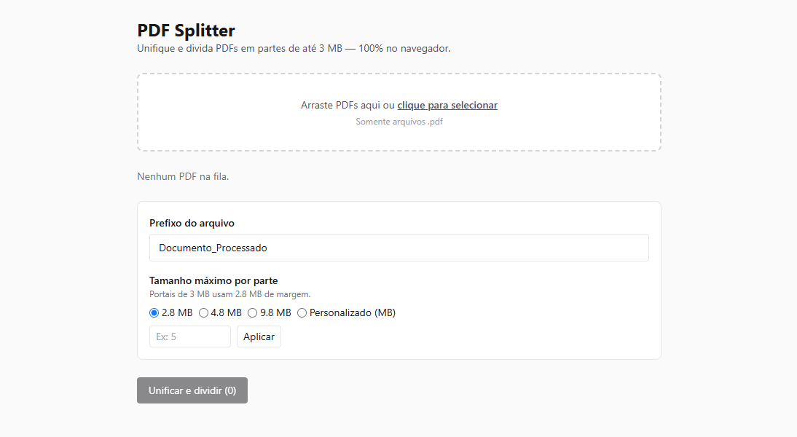

# PDF Splitter

[](https://github.com/herloncosta/pdf-splitter-app/actions/workflows/ci.yml)
[](LICENSE)
[](https://nextjs.org/)

> Unifique múltiplos PDFs e divida em partes de até 3 MB — tudo no navegador. Nenhum documento sai do seu computador.



## O problema

Portais de peticionamento e sistemas corporativos rejeitam anexos acima de alguns MB. Juntar vários PDFs escaneados e quebrá-los manualmente no tamanho certo é lento e propenso a erro. O PDF Splitter faz isso em segundos, com cada parte preenchida até o limite.

## Funcionalidades

- **Unificar N PDFs** com reordenação por arrastar-e-soltar (mouse e teclado)
- **Divisão automática** respeitando o limite configurado (padrão 2,8 MB, margem segura para portais de 3 MB)
- **Download individual** por parte ou **tudo em `.zip`**
- **Alerta de página estourada**: se uma única página já passa do limite, ela é entregue sinalizada em vez de travar o processo
- **100% client-side**: sem servidor, sem upload, sem conta

## Como usar

1. Arraste os PDFs para a área de upload (ou clique para selecionar)
2. Reordene a fila, ajuste o prefixo do nome e o tamanho máximo por parte
3. Clique em **Unificar e dividir** e baixe as partes ou o `.zip`

## Rodando localmente

Pré-requisitos: Node.js 20+.

```bash
npm install
npm run dev      # http://localhost:3000
npm run build    # gera a pasta out/ (site 100% estático)
```

## Testes

```bash
npx vitest run       # 46 testes unitários/integração
npx playwright test  # 3 fluxos E2E no Chromium (upload → split → zip)
node tests/e2e/fixtures/generate.mjs  # regenera os PDFs de teste
```

## Stack

Next.js 15 (export estático) · TypeScript · Tailwind CSS · pdf-lib · JSZip · dnd-kit · react-dropzone · Vitest · Playwright

Arquitetura: DDD + Clean Architecture (domínio puro, casos de uso via Ports, adapters finos) com TDD.

## Privacidade

Todo o processamento acontece na memória do seu navegador via Web APIs + `pdf-lib`. O app não faz nenhuma requisição de rede com os seus documentos — há um teste E2E que falha se qualquer request sair de `localhost`.

## Deploy

Qualquer hospedagem estática funciona (`out/` após `npm run build`): Vercel, Netlify, GitHub Pages ou qualquer CDN.

## Contribuindo

1. Faça um fork e crie uma branch (`git checkout -b feat/minha-ideia`)
2. Mantenha o ciclo TDD do projeto e rode `npx vitest run && npx tsc --noEmit`
3. Abra um Pull Request descrevendo o comportamento esperado

## Licença

MIT — veja [LICENSE](LICENSE) para detalhes.
